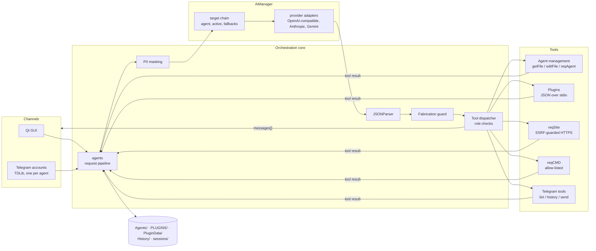
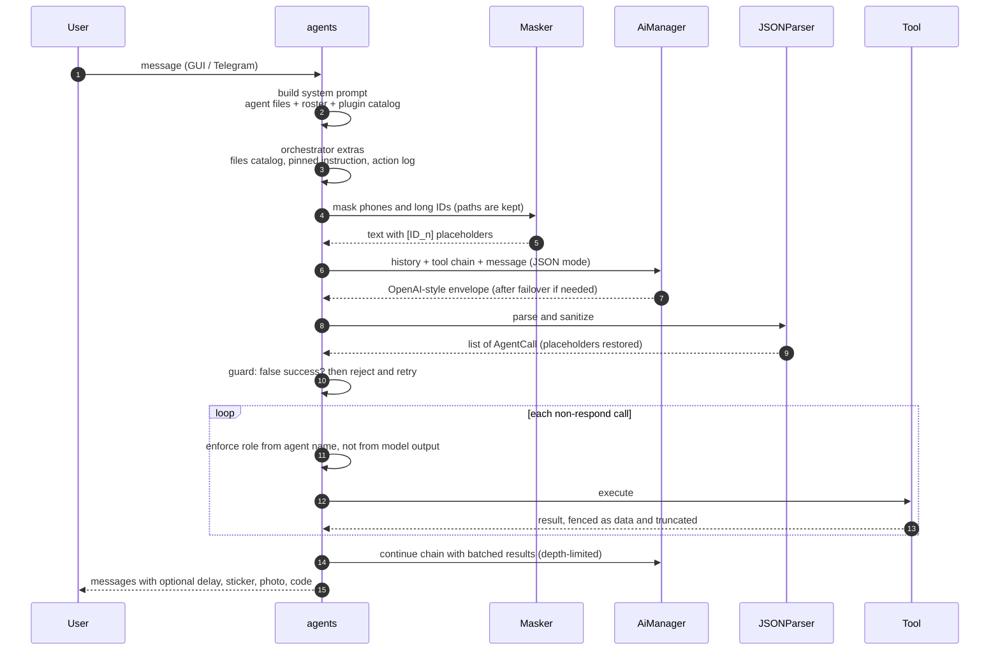

<div align="center">

# 🧠 Agents Orchestrator

**A native Qt 6 desktop runtime for multi-agent LLM systems**
with multi-provider failover, sandboxed tool-calling, a plugin protocol, PII masking and Telegram account integration.


[Overview](#-overview) · [Architecture](#-architecture) · [AI providers](#-ai-providers-and-failover) · [Tool protocol](#-tool-calling-protocol) · [Reliability](#-keeping-the-model-honest) · [Security](#-security-model) · [Plugins](#-plugin-system) · [Getting started](#-getting-started) · [Configuration](#-configuration-reference) · [Limitations](#-known-limitations--roadmap)

<!-- Add a screenshot or GIF of the UI here:

-->

</div>

---

## ✨ Overview

Agents Orchestrator lets you run a **team of LLM agents** from a single desktop app. One **orchestrator** agent manages any number of **sub-agents**: it creates them, rewrites their prompts, delegates work, runs plugins and talks to the outside world through a controlled set of tools. Agents are reachable from the built-in GUI and, per agent, from a real Telegram user account.

It is written in modern C++20 on top of Qt 6 and keeps the trust boundary in **code, not in the prompt**: roles, permissions, network access and command execution are enforced by the host regardless of what the model says. Model output is treated as untrusted, and the host actively checks it for fabricated results.

### Highlights

| | |
|---|---|
| 🤝 **Orchestrator / sub-agent model** | Hierarchical agents with role-based permissions. Sub-agents can only report back to the orchestrator. |
| 🔀 **Multi-provider with failover** | OpenRouter, OpenAI, Anthropic, Gemini, Groq, DeepSeek, xAI or any OpenAI-compatible host. Per-agent targets and an ordered fallback chain. |
| 🔧 **Structured tool calling** | Model replies are parsed into a typed call stack, executed (in parallel batches) and fed back in a bounded loop. |
| 🧾 **Anti-fabrication guard** | Replies that claim success without a tool call, or cite files that do not exist, are rejected and retried. Poisoned history entries are filtered out. |
| 📌 **Chat memory beyond history** | Pinned user instruction, a log of real function calls and a live catalog of generated files are injected into the orchestrator's context. |
| 🔌 **Language-agnostic plugins** | Any executable that speaks one JSON object on stdin/stdout becomes a tool. Per-plugin timeout, settings and data directory. |
| 🛡️ **Defense in depth** | SSRF guard, command allow-list, path-traversal checks, prompt-injection fencing, Telegram user allow-list. |
| 🕶️ **PII masking** | Phone numbers and long numeric IDs are replaced with stable placeholders before leaving the machine and restored in the model's reply. |
| 💬 **Telegram user accounts** | One TDLib session per agent: incoming private messages are routed to the agent; tools list chats, read history and send messages. |
| 🎨 **Polished UI** | "Liquid glass" theming, built-in themes + custom palettes, animated backdrops. |

---

## 🏗 Architecture



### Request lifecycle



**Key mechanics**

1. **Prompt assembly.** The system prompt is the agent's `soul`, `min_info`, `system_prompt` and `stickers` files, followed by a system note: the roster of sub-agents, a catalog of plugins (name, title and function list parsed from each `SKILL.md`) and the `reqCMD` allow-list.
2. **Orchestrator context.** For the orchestrator only, the prompt additionally carries a catalog of media files on disk (newest first), the user's pinned instruction, the log of recent real function calls and a reminder to answer with a function call rather than a text "Done".
3. **History.** Past exchanges are loaded from `History/<chatId>.jsonl` (each field clipped, total size capped) and replayed as user/assistant pairs. Entries that look fabricated are dropped on load.
4. **Parallel batches.** If one reply contains several tool calls, their results are collected and sent back to the model as a single continuation message.
5. **Bounded loop.** Chain depth per chat is capped (`kMaxToolDepth`); exceeding it raises `TOOL_LOOP_LIMIT`. Each tool result is truncated to `kMaxToolResultChars` and prefixed with a notice that it is *data, not instructions*.
6. **Retry policy.** `408`, `429`, `500`, `502`, `503`, `504`, `rate_limit_exceeded` and overload errors retry with exponential back-off (`kRetryBaseDelayMs · 2ⁿ`, up to `kMaxRetries`) **without resetting the chain-depth counter**. `401` and `402` are never retried and are reported at once (`AI_AUTH_ERROR`, `AI_NO_CREDITS`).
7. **Truncation awareness.** `finish_reason == "length"` is detected, and the error tells the user to raise `ai_max_tokens` instead of reporting a generic parse failure.

All numeric limits (`kMaxToolDepth`, `kMaxRetries`, `kMaxGuardTries`, `kPinMinChars`, `kPinMaxChars`, `kMaxActionLog`, `kFilesCatalogLimit`, `kCmdTimeoutMs`, `kTgTimeoutMs`, …) are compile-time constants in `agents.h`.

---

## 🔀 AI providers and failover

`AiManager` sits between the pipeline and the network. Adapters translate the internal request into each vendor's wire format and normalize every answer (success **and** error) into one OpenAI-style envelope, so the rest of the code never branches on the vendor.

| Preset | Adapter type | Host |
|---|---|---|
| `openrouter` | `openai` | `openrouter.ai` |
| `openai` | `openai` | `api.openai.com` |
| `groq` | `openai` | `api.groq.com` |
| `deepseek` | `openai` | `api.deepseek.com` |
| `xai` | `openai` | `api.x.ai` |
| `anthropic` | `anthropic` | `api.anthropic.com` |
| `gemini` | `gemini` | `generativelanguage.googleapis.com` |

Any other `[provider_<name>]` section with `type=openai`, `host` and `path` works as a custom OpenAI-compatible endpoint (HTTPS on port 443).

**Target selection.** A target is `provider` or `provider:model`. For each request the chain is built as:

1. the agent's own target from `[agent_targets]` (if set),
2. the active target `[ai] provider`,
3. every entry of `[ai] fallback`, in order,

with duplicates removed. Providers without an API key or a model are skipped.

**When it fails over.** Authentication and billing errors, rate limits, 5xx, network errors and unparseable responses move on to the next target. Other client errors (for example an invalid request) are returned immediately, because another provider would not fix them.

API keys come from `api_key` in the provider section or from the environment variable `<PROVIDER>_API_KEY` (e.g. `GROQ_API_KEY`). Old configs that only have `openrouter_api_key` and `ai_model` keep working through a compatibility path.

---

## 🔧 Tool-calling protocol

The model must answer with a single JSON object:

```json
{
  "function_call_stack": [
    {
      "id": "1",
      "functionName": "respond",
      "args": {
        "messages": [
          { "text": "Done. Here's the script:", "delay": 0 },
          { "text": "", "code": "print('hello')" }
        ]
      }
    }
  ]
}
```

The parser is deliberately tolerant. It strips Markdown fences and trailing text, removes provider noise such as Gemini's `thoughtSignature`, accepts the stack bare, as an array, or wrapped in `agent_controls_context`, and accepts `name` for `functionName`. If the text is not valid JSON, a brace-matching scanner extracts the first object that actually looks like a call stack.

> [!NOTE]
> `agentName` and `role` fields in the model's output are **ignored**. The host derives the caller's identity and role itself (`Constants::kMainAgentName` ⇒ orchestrator, everything else ⇒ sub-agent), so a model cannot promote itself by claiming a different role.

A `messages[]` entry supports `text`, `delay` (clamped), `stickerId` (or `sticker`), `photoUrl` and `code`. Messages go to the originating channel and the reply text is saved to the chat history.

### Built-in tools

| Tool | Orchestrator | Sub-agent | Arguments |
|---|:-:|:-:|---|
| `respond` | ✅ | ✅ | `messages[]` |
| `createAgent` | ✅ | ❌ | `agentName`, `purpose` |
| `deleteAgent` | ✅ | ❌ | `agentName` (the main agent is protected) |
| `changeAgentName` | ✅ | ❌ | `oldName`, `newName` |
| `editFile` | ✅ | ❌ | `agentName`, `fileToEdit` ∈ `soul \| min_info \| system_prompt \| stickers`, `content` |
| `getFile` | ✅ | ❌ | `agentName`, `fileToGet` (same set) |
| `reqAgent` | ✅ any agent | ⚠️ orchestrator only | `agentName`, `prompt`, `chatId`¹, `photoB64`, `code`² |
| `reqCMD` | ✅ | ❌ | `program`, `cmdArgs[]` |
| `reqSite` | ✅ | ✅ | `host`, `path`, `method` ∈ `GET \| POST`, `body`, `headers` |
| `getPluginSkill` | ✅ | ✅ | `pluginName` |
| `GetChatTgList` | ✅ | ✅ | `limit` |
| `GetChatTgHistory` | ✅ | ✅ | `chatId`, `limit` |
| `SendMsgToTgUser` | ✅ | ✅ | `chatId`, `text` |
| *plugin functions* | ✅ | ✅ | defined by each plugin's manifest |

<sub>¹ Honored only for the orchestrator; sub-agents always stay in their own chat. ² Sub-agent only: code to attach to the final message.</sub>

Argument names are accepted in both `camelCase` and `snake_case` (`agentName` / `agent_name`) to tolerate model drift. Built-in tools report back as `OK: …` or `ERROR: …` with a label, which the model sees as a tool result.

### Delegation

When the orchestrator calls `reqAgent`, the target agent starts a fresh chain and its own `respond` calls are **suppressed**: the user only hears from the orchestrator. The sub-agent finishes by calling `reqAgent` back to the orchestrator with its result. The orchestrator relays it through `respond`, and any `code` is attached to the outgoing message automatically, so the model does not have to copy it. A sub-agent may call only the orchestrator, never another sub-agent.

---

## 🧾 Keeping the model honest

Language models like to say "Done!" Several mechanisms make that unprofitable.

| Mechanism | What it does |
|---|---|
| **Fabrication guard** | If an orchestrator reply consists only of `respond` and (a) mentions a file path that does not exist, or (b) uses success wording with no tool call in this turn, it is rejected. The pipeline drops it, tells the model what was wrong and asks again, up to `kMaxGuardTries`; after that the user gets an honest failure message. |
| **History sanitizing** | Old answers that would trip the same check are removed from the replayed history so the model cannot copy its own earlier fabrications. |
| **Files catalog** | The prompt lists real media files from `PluginData/` (path, size, modified time). The model is told to take paths only from there or from tool results. |
| **Path repair** | Media paths in plugin arguments that do not exist are re-resolved by file name against `PluginData/` (newest match wins) and logged. Keys such as `output`, `filename`, `prompt` are left untouched. |
| **Pinned instruction** | A long user message (≥ `kPinMinChars`) is saved per chat in `PluginData/_chat_state/<chatId>.pinned.txt` and re-injected as standing rules (voice, model, format). The model is told not to re-execute it unprompted. |
| **Action log** | The last real function calls and their arguments are shown to the orchestrator, so texts, file names and parameters survive long chats. |
| **`/reset`** | Sent to the main agent, clears the pinned instruction, action log and guard counters for that chat. |

> [!NOTE]
> The guard's wording check and the path recognizer are currently tuned for **Russian-language prompts and Windows drive paths** (`C:\…`). See [limitations](#-known-limitations--roadmap).

---

## 🛡 Security model

LLM agents with tools are an attack surface. The guiding rule is **never trust model output for authorization**.

| Threat | Mitigation |
|---|---|
| **Privilege escalation via model output** | Role is computed from the agent's name; role and name fields in the response are discarded. |
| **Arbitrary command execution** | `reqCMD` is orchestrator-only, takes a bare program name (no `/` or `\`), checks it against `cmd_allowlist` (default: `ls echo pwd whoami date hostname gflow`), passes arguments as a list (no shell) and enforces a timeout. |
| **SSRF through `reqSite`** | Hosts are rejected if they are `localhost`, `*.local`, `*.internal`, contain `/ @` or spaces, or are IP literals in loopback, link-local, multicast, ULA, `0/8`, `10/8`, `100.64/10`, `127/8`, `169.254/16`, `172.16/12` or `192.168/16`. Only `GET`/`POST` over TLS on port 443. |
| **Prompt injection via tool output or Telegram text** | Tool results are wrapped with an explicit "data, not instructions" preamble; inbound Telegram text is labelled as external data. |
| **Fabricated results** | See [Keeping the model honest](#-keeping-the-model-honest). |
| **Path traversal via agent names** | Names must match `^[\p{L}\p{N}_ -]{1,64}$` with no leading or trailing whitespace before touching the filesystem. |
| **Plugin escape** | An `exec` containing a path must canonicalize to a location **inside** the plugin directory (checked with a `root + "/"` prefix, defeating sibling tricks such as `plugin` vs `plugin-evil`). Each plugin runs under a hard timeout. |
| **Unwanted Telegram senders** | Optional `tg_allowed_users`; bots, channels, group chats, Telegram's service account (`777000`) and messages older than 60 s are dropped. |
| **Runaway tool loops** | Chain-depth limit per chat. |
| **Self-destruction** | The main agent cannot be deleted or renamed by tool calls; an empty `agentName` does not fall back to the caller. |

### 🕶 PII masking

Before text is sent to a provider, phone-like sequences and numbers of 6+ digits are swapped for stable placeholders. The mapping lives in memory per chat.

```text
User text    → "Write to +380 50 123 4567 and to chat -1001234567890"
Sent to LLM  → "Write to [ID_1] and to chat [ID_2]"
LLM args     → { "chatId": "[ID_2]" }
After restore→ { "chatId": "-1001234567890" }   ← tools see real values
```

ISO dates (`YYYY-MM-DD`) are left alone, and **file paths are shielded** from masking so digits in a path are never replaced. Restoration is applied recursively to every string in the call arguments and tolerates the model dropping the brackets (`ID_2`).

---

## 💬 Telegram integration

Each agent can own a Telegram **user account** through TDLib (`libtdjson`, loaded at runtime). The application works without TDLib; account features then report a clear error.

- **Sessions** live in `sessions/<agent>/` (spaces become `_`). At startup every agent with a saved session (`td.binlog` or `db.sqlite`) is connected. First-time sign-in uses code and optional 2FA dialogs.
- **Incoming** messages are routed to the agent only if they are from a real user (not a bot, channel or `777000`), in a **private** chat, fresh (< 60 s), of a supported content type, and, if `tg_allowed_users` is set, from an allowed ID. Non-text content arrives as a short preview (`[Photo]`, `[Voice]`, …).
- **Tools** for the agent: `GetChatTgList`, `GetChatTgHistory`, `SendMsgToTgUser`. They wait for the session to become ready and time out with a readable error if Telegram does not answer.
- **Library lookup order:** next to the executable → `../Frameworks` → project directory → system paths → Homebrew.

---

## 🔌 Plugin system

A plugin is a directory under `PLUGINS/`. Anything executable works: Python, Node, Go, Rust, a shell script.

```text
PLUGINS/
└── text-tools/
    ├── manifest.md     # JSON manifest (the file is named manifest.md)
    ├── SKILL.md        # usage instructions served to the model on demand
    └── main.py
```

**Manifest**

```json
{
  "exec": "python3",
  "args": ["main.py"],
  "timeout_ms": 30000,
  "functions": [
    { "name": "text_upper" }
  ]
}
```

`exec` is resolved as follows: if it contains a path separator it must resolve **inside** the plugin folder; otherwise a file of that name in the plugin folder wins; otherwise it is looked up as a program on `PATH` (e.g. `python3`). The process starts with the plugin folder as working directory. `timeout_ms` defaults to 30000.

**`SKILL.md` conventions.** The first `# Title` line and every `## Function: name` heading are parsed into the plugin catalog shown to agents. The full file is returned on demand by `getPluginSkill`, which keeps the base prompt small. The host tells the model to read it before first use.

**Contract.** The host writes **one line of JSON** to stdin and closes it; the plugin replies with **one JSON object** on stdout and nothing else.

```jsonc
// stdin
{
  "function": "text_upper",
  "args": { "text": "hello" },
  "context": {
    "chatId": "-1",
    "dataDir": "/…/PluginData/text-tools",   // private persistent storage
    "settings": { "api_key": "…" }            // from [plugin_text-tools] in config.ini (all values are strings)
  }
}

// stdout
{ "ok": true, "message": "HELLO" }
```

On `ok: false` the model receives `Ошибка: <message>`. A crash, a timeout, a start failure or non-JSON output is converted into a readable error result too (non-JSON output includes the process's stderr).

**Write errors for the model, not for a human.** The message is read by an LLM that decides what to do next, so say what happened, whether credits or side effects occurred, whether a retry makes sense and what the user must do. A stable code line (for example `Код: auth_required`) makes this reliable.

**Reference implementation**

```python
#!/usr/bin/env python3
import json, sys

req = json.loads(sys.stdin.readline())

if req["function"] == "text_upper":
    out = {"ok": True, "message": req["args"].get("text", "").upper()}
else:
    out = {"ok": False, "message": f"unknown function {req['function']}"}

print(json.dumps(out))
```

Plugins are processes, so you can test one from a shell: `echo '{…}' | ./main.py`.

---

## 🚀 Getting started

### Prerequisites

- **Qt 6** (`Core`, `Gui`, `Widgets`, `Network`) with SSL support
- A **C++20** compiler (GCC 11+, Clang 14+, MSVC 2022)
- An API key for at least one [supported provider](#-ai-providers-and-failover) (e.g. [OpenRouter](https://openrouter.ai/keys))
- *(optional)* [TDLib](https://github.com/tdlib/td) `libtdjson` plus Telegram `api_id` / `api_hash` for user accounts

### Build

The code expects an `APP_SRC_DIR` compile definition pointing at the source directory, where `config.ini` lives.

```cmake
find_package(Qt6 REQUIRED COMPONENTS Core Gui Widgets Network)

target_compile_definitions(agents_orchestrator PRIVATE
    APP_SRC_DIR="${CMAKE_CURRENT_SOURCE_DIR}")

target_link_libraries(agents_orchestrator PRIVATE
    Qt6::Core Qt6::Gui Qt6::Widgets Qt6::Network)
```

```bash
cmake -B build -DCMAKE_BUILD_TYPE=Release
cmake --build build -j
./build/agents_orchestrator
```

### Configure

Create `config.ini` in the source directory. Provider keys can also come from environment variables.

```ini
ai_max_tokens=2048

; Telegram user accounts (optional)
api_id=12345
api_hash=0123456789abcdef0123456789abcdef
tg_allowed_users=111111111,222222222

; Programs reqCMD may run (lowercase names)
cmd_allowlist=ls,echo,pwd,whoami,date,hostname,gflow

[ai]
provider=openrouter:openai/gpt-4o-mini
fallback=groq:llama-3.3-70b-versatile,deepseek

[provider_openrouter]
api_key=sk-or-v1-…
model=openai/gpt-4o-mini

[provider_groq]
api_key=gsk_…
model=llama-3.3-70b-versatile

[provider_deepseek]
api_key=sk-…
model=deepseek-chat

; Optional: pin a specific agent to a specific target
[agent_targets]
Researcher=anthropic:your-model-id

; Optional: settings delivered to a plugin as context.settings
[plugin_gflow]
allow_video=false
```

> [!WARNING]
> `config.ini` holds secrets in plain text. Add `config.ini`, `sessions/`, `Agents/`, `PluginData/`, `History/` and `*.jsonl` to your `.gitignore`.

### First run

1. Launch the app. The orchestrator (**Главный агент** by default) is created on disk automatically.
2. Open its settings (⚙) and write its **Soul** and **System Prompt**, including the call-stack format from [Tool-calling protocol](#-tool-calling-protocol).
3. Ask it to create a sub-agent, or press **+** in the sidebar.
4. *(Optional)* Connect Telegram under **Agent settings → Services → Telegram**.

---

## ⚙️ Configuration reference

| Key | Default | Description |
|---|---|---|
| `[ai] provider` | – | Active target: `provider` or `provider:model` |
| `[ai] fallback` | – | Comma-separated targets tried in order on failover errors |
| `[provider_<name>] type` | from preset | `openai`, `anthropic` or `gemini` |
| `[provider_<name>] host`, `path` | from preset | Endpoint (HTTPS, port 443) |
| `[provider_<name>] api_key` | `$<NAME>_API_KEY` | Credential |
| `[provider_<name>] model` | – | Default model for this provider |
| `[provider_<name>] quirks` | – | Provider-specific tweaks (e.g. `openrouter`) |
| `[provider_<name>] header_<Name>` | – | Extra HTTP header sent with every request |
| `[agent_targets] <agent>` | – | Per-agent `provider[:model]` override |
| `ai_max_tokens` | built-in default | Output token cap per request |
| `openrouter_api_key`, `ai_model` | – | Legacy keys, used only if no `[provider_*]` section exists |
| `api_id`, `api_hash` | – | Telegram application credentials for TDLib sessions |
| `tg_allowed_users` | *(empty = everyone)* | Comma-separated Telegram user IDs allowed to talk to account-backed agents |
| `cmd_allowlist` | `ls,echo,pwd,whoami,date,hostname,gflow` | Programs `reqCMD` may run (compared in lowercase) |
| `theme` | `dark` | `dark` `light` `nord` `nordlight` `sunset` `sunsetlight` `pink` `pinkdark` `custom` |
| `backdrop_mode` | `gradient` | `gradient` `aurora` `particles` `starfall` `image` `none` |
| `backdrop_animation` | `true` | Toggle backdrop animation |
| `backdrop_image_path` | – | Image or GIF used when `backdrop_mode=image` |
| `[theme_<id>]` / `[custom_theme]` | – | Per-theme colour overrides (`bg panel card border text accent accent2 success danger`) |
| `[plugin_<name>]` | – | Free-form key/values delivered to that plugin as `context.settings` |

---

## 🗂 Project layout

```text
├── agents.cpp                  Core: prompt assembly, request pipeline, retries, fabrication guard,
│                               tool dispatcher, agent lifecycle, plugin runner
├── aimanager.cpp               Providers, target chain, failover
├── aiprovider*                 Wire-format adapters (OpenAI-compatible, Anthropic, Gemini)
├── jsonparser.cpp              Tolerant model-output → AgentCall parser
├── phonenumber.cpp             Reversible PII masking
├── skillmanager.cpp            Plugin manifests, function registry, SKILL.md access
├── filemanager.cpp             Agent files and JSONL conversation history
├── requests.cpp                Minimal TLS HTTP/1.1 client (chunked decoding included)
├── telegramaccountclient.cpp   TDLib JSON client: auth, chats, history, send, incoming filter
├── mainwindow.cpp              Qt Widgets UI, theming, chat, settings, code panel
└── liquidglass.*               Glass rendering and colour tokens
```

Runtime data:

```text
<app dir>/
├── Agents/<name>/{soul,min_info,system_prompt,stickers}.md
├── PLUGINS/<plugin>/{manifest.md,SKILL.md,…}
├── PluginData/<plugin>/         plugin storage and generated files
├── PluginData/_chat_state/      pinned instructions per chat
├── History/<chatId>.jsonl       conversation history
└── sessions/<agent>/            TDLib databases
```

---

## 🧭 Design decisions

- **Policy lives in C++, not in prompts.** Prompts are persuasion; code is enforcement. Anything with side effects is validated host-side.
- **Distrust the model's reports, not only its commands.** A claimed result must be backed by a tool call and an existing file.
- **One envelope for every vendor.** Adapters normalize requests and errors, so retry, failover and parsing logic exist once.
- **Everything is asynchronous.** Network calls, processes and Telegram requests are signal/slot driven; the UI thread never blocks. Every long-running operation has a timeout and a single-completion guard so callbacks cannot fire twice.
- **Fail loud, in the user's language.** Provider errors are decoded and surfaced in the chat instead of being swallowed in logs.
- **Small dependency surface.** Only Qt. TDLib is loaded via `QLibrary`, and the HTTPS client is a small layer over `QSslSocket`.
- **Plugins are processes, not shared libraries.** Crash isolation, any language, trivially testable from a shell.

---

## 🗺 Known limitations & roadmap

- [ ] `Requests::apiCall` has no request timeout; a connection that hangs without closing never completes. Add a per-request timer.
- [ ] `reqSite` checks IP literals and host names only; it does not resolve DNS, so a public name pointing at a private address (DNS rebinding) is not caught.
- [ ] The HTTP client supports only TLS on port 443, no redirects. Local HTTP endpoints (e.g. a local model server) cannot be used as a provider.
- [ ] The fabrication guard and path shielding recognize only Windows drive paths and Russian success wording. Generalize to POSIX paths and make the phrase list configurable.
- [ ] User-facing error strings in the retry and parser code still say "OpenRouter" even when another provider failed. Use the provider name from the envelope.
- [ ] Persist the GUI chat-ID ↔ agent mapping across launches and keep conversation history under a fixed application data directory.
- [ ] Persist per-agent service credentials (Instagram / WhatsApp / Discord are UI stubs today; Telegram is functional).
- [ ] Encrypt secrets at rest (OS keychain via QtKeychain) instead of plain `config.ini`.
- [ ] Streaming responses and token-usage accounting.
- [ ] Automated tests for `JSONParser`, masking, the SSRF filter and the fabrication guard (all are pure functions and easy to cover).

---

<div align="center">

Built with Qt, C++20 and a healthy distrust of model output.

</div>